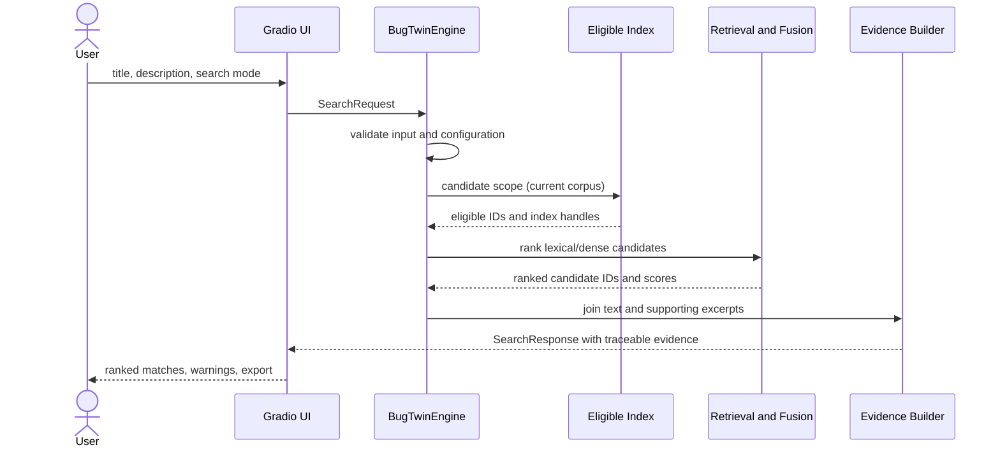
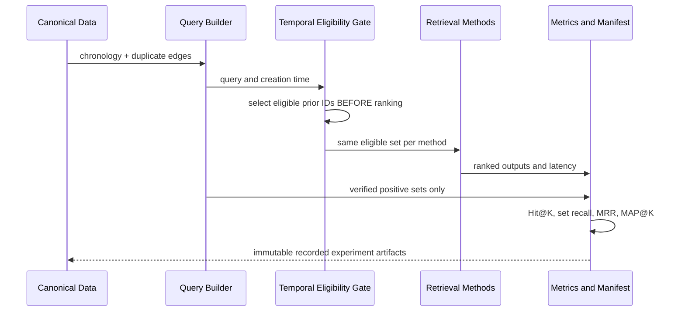

# BugTwin — Complete Architecture and Stakeholder Maps

**Document ID:** BT-ARCH-001  
**Version:** 1.0  
**Date:** 25 October 2026  
**Status:** Design baseline; implementation and dataset validation pending  
**Parent specification:** BT-SPEC-001, consolidated as `BugTwin_Master_Specification_v1.1.md`  
**System:** BugTwin — Semantic Duplicate Bug Report Detection and Retrieval  
**Deployment constraint:** A single Python Jupyter notebook running in Google Colab.

> **Design authority.** This document is the architecture baseline for BugTwin's implementation. It describes intended behavior, not completed software. Any numerical performance values below are targets rather than measured results. This document and BT-SPEC-001 must be updated together when a significant design decision changes.

## A1. Architectural goals and boundaries

BugTwin ingests a validated historical issue corpus, searches it using lexical and neural NLP methods, ranks plausible duplicates of a new issue, displays original supporting issue text, and exposes a reproducible offline evaluation. The goal is assisted duplicate discovery; BugTwin does **not** automatically close issues or prove two bugs share the same root cause.

**In scope (initial release):** CSV and source-specific dataset ingestion; canonical schema and duplicate relationships; lexical baselines; sentence-transformer embeddings; exact dense search; hybrid retrieval; optional cross-encoder reranking; chronological evaluation; Gradio UI; explainable source excerpts; review decisions and exports; notebook-contained tests.

**Out of scope:** persistent multi-user database; SSO; issue-tracker write-back; background monitoring; externally hosted inference API; actual causal root-cause diagnosis; paid LLM; autonomous issue merging; UI/code in separate `.py`, JavaScript, or server project files.

**Architectural quality attributes in priority order:** correctness and evaluation integrity; portability and reproducibility; user trust and evidence traceability; useful retrieval accuracy; graceful degradation; interactive latency; extensibility.

## A2. Architectural views (C4-style adaptation)

### A2.1 System context


**Human actors:** developer or QA reporter (submits issue), triage maintainer (checks and labels matches), ML researcher/evaluator (runs experiments), notebook maintainer (operates the system). **External resources:** public bug data repository, model package repository, optional private Google Drive cache. **Runtime:** Google Colab session; Gradio served by that session. The public-share link is optional and must be treated as potentially accessible by anyone possessing it.

**Trust boundaries:** (T1) uploaded report text crosses into the Colab runtime; (T2) remote datasets and model weights are downloaded; (T3) a publicly shared UI may expose data; (T4) exports leave the runtime. The notebook must validate file types, handle user text as untrusted, avoid unsafe deserialization, and not ship secrets.

### A2.2 Logical container architecture (all inside one notebook)


This diagram shows **logical components, not deployable services**. No microservices, server-side Python modules, or database are required. Python cells define cohesive classes/functions with typed contracts. The notebook orchestrates batch preparation and a lightweight query runtime.

| Logical layer | Primary components | Inputs → outputs | Failure or fallback |
|---|---|---|---|
| Runtime bootstrap | `AppConfig`, environment validator, artifact registry | config, pinned dependencies → runtime manifest | stop with diagnostic for essential conflicts |
| Data acquisition | source adapter, upload adapter, checksum recorder | raw source / CSV → staging DataFrame | reject bad columns, record source failure |
| Canonicalization | validator, text processor, duplicate-link resolver | staging → `BugReport[]`, `DuplicateEdge[]` | quarantine malformed rows; report counts |
| Dataset/evaluation | chronological splitter, eligibility gate, query builder | reports + labels → reproducible split and query set | exclude ineligible query with reason |
| Retrieval indexes | TF-IDF, BM25, MiniLM encoder, dense matrix/FAISS | eligible historical reports → indexes | lexical-only fallback if model fails |
| Ranking | parallel candidate generators, RRF, optional cross-encoder | query + eligible candidates → ordered IDs/scores | skip failed reranker; log degradation |
| Evidence | metadata join, terms/excerpts, score semantics | ranked IDs → traceable candidate cards | return partial evidence rather than invent text |
| App orchestration | `BugTwinEngine` | validated request → structured `SearchResponse` | typed error to interface |
| Presentation | Gradio Blocks, dataset explorer, results/export | request/response → interactive UI | clear user error, no raw tracebacks |
| Experimentation | metrics, ablations, latency, test runner | queries/results → benchmark tables/manifests | report failed/partial runs accurately |

**Critical separation:** offline benchmark methods cannot call the interactive UI to define a candidate set. The UI cannot re-fit models or consume ground-truth duplicate labels during a user query. Common retrieval primitives are shared between modes.

### A2.3 Core component dependency rule

`Gradio UI → BugTwinEngine → SearchOrchestrator → {LexicalRetriever, DenseRetriever, Fusion, Reranker} → IndexRegistry`.

`DatasetLoader → SchemaAdapter → Validator → CanonicalStore → {IndexBuilder, EvaluationBuilder}`.

`Evaluator → SearchOrchestrator` using an injected **time-constrained candidate provider**, independent of Gradio.

The engine returns Python data objects/dictionaries, never Gradio widget objects. The UI renders those outputs. This preserves testability inside one notebook.

### A2.4 In-memory and disk layout

All code is in `BugTwin.ipynb`. Session-generated data may appear in `/content/bugtwin_runtime/`:

```text
/content/bugtwin_runtime/             # generated data only, not source code
  data/raw/                          # original downloaded/uploaded bytes
  data/normalized/                   # sanitized canonical tables
  cache/embeddings/                  # reusable dense vectors
  cache/indexes/                     # optional serialized indexes
  experiments/                       # immutable run-scoped metrics/manifests
  exports/                           # result CSV/JSON for user download
  logs/                              # redacted diagnostic logs
```

The notebook can rebuild these artifacts. A Drive copy is optional and must be versioned. A cache is only loaded if dataset SHA-256, model name/revision, normalization policy, dimension, and index configuration match.

## A3. Stakeholder architecture

### A3.1 Stakeholder register

| ID | Stakeholder | Goal / incentive | Main concern | Influence | Interest | Engagement and decision rights |
|---|---|---|---|---:|---:|---|
| ST-01 | Developer / bug submitter | Rapid discovery of already-reported issues | Irrelevant or missing matches | 3/5 | 5/5 | User tests; controls review of own result |
| ST-02 | QA engineer / triage analyst | Reduce duplicate-review workload | False positives, evidence clarity | 4/5 | 5/5 | Defines acceptance cases and reviews matches |
| ST-03 | Project maintainer / issue owner | Reliable backlog quality | Wrong merges, unsound automation | 5/5 | 5/5 | Final duplicate/merge decision, never delegated to model |
| ST-04 | NLP / ML implementer | Correct, maintainable pipeline | Leakage, non-reproducible scores | 5/5 | 5/5 | Owns architecture, models, tests, releases |
| ST-05 | Academic reviewer / evaluator | Verifiable technical contribution | Unfair baselines, unsupported claims | 4/5 | 4/5 | Reviews protocol and reported experiments |
| ST-06 | Data source / dataset steward | Correct attribution, permissible use | Licensing, schema misinterpretation | 4/5 | 3/5 | Controls terms of source; consulted on provenance |
| ST-07 | Security / privacy reviewer | Avoid exposing report data | Secrets, public link, unsafe files | 5/5 | 4/5 | Can block unsafe demo deployment |
| ST-08 | Colab / library providers | Supported runtime compatibility | Session eviction, API changes | 3/5 | 2/5 | External dependency, not project sign-off |
| ST-09 | Portfolio viewer / hiring assessor | Demonstrable, readable software | Non-running notebook, shallow evaluation | 2/5 | 4/5 | Validates reproducibility and presentation |

*Stakeholder roles may be carried by the same person during solo development; the responsibilities remain separate for review and evidence.* Influence/interest scores are design estimates, not externally measured facts.

### A3.2 Power-interest stakeholder map


- **Manage closely:** project maintainer, QA, NLP implementer, security reviewer, academic evaluator.
- **Keep satisfied:** dataset steward and platform dependencies to the degree relevant to source terms and runtime changes.
- **Keep informed:** developers and portfolio viewers; collect usability feedback at release gates.
- **Monitor:** peripheral platform/service changes that do not affect mandatory functionality.

The diagram is directional, not a claim that a public OSS maintainer has actually participated in this project.

### A3.3 Stakeholder relationship and influence map


The query user requests assistance; the retrieval system presents candidates; the human triage owner decides duplicates. The data steward controls source constraints. The security reviewer controls sharing risk. The evaluator judges empirical claims. The developer owns reproducible implementation.

### A3.4 RACI matrix

**R = Responsible; A = Accountable; C = Consulted; I = Informed.** Abbreviations: DEV (project implementer), QA, MAINT (issue maintainer), EVAL (academic evaluator), DATA (dataset steward), SEC (privacy/security reviewer).

| Activity | DEV | QA | MAINT | EVAL | DATA | SEC |
|---|---|---|---|---|---|---|
| Product scope and success criteria | R | C | A | C | I | C |
| Dataset access, attribution, provenance | R | I | I | C | A | C |
| Ground-truth policy / chronological design | R | C | I | A | C | I |
| Retriever selection and tuning | A/R | C | I | C | I | I |
| UI workflow and evidence usability | R | A | C | I | I | C |
| Accept or reject duplicate in actual tracker | I | R | A | I | I | I |
| Data sharing / public demo approval | R | I | I | I | C | A |
| Benchmark claims and research reporting | R | C | I | A | I | I |
| Release readiness and reproducibility | A/R | C | C | C | I | C |

**RACI interpretation:** when working as an individual portfolio developer, DEV assumes practical execution, while MAINT/EVAL/SEC represent required review perspectives rather than falsely implied participating employees.

### A3.5 Stakeholder journeys

**Developer journey:** open notebook UI → choose dataset/project → paste title/description → select search method → inspect top 5 matches → open original issue text → export results. Friction: obscure scores, long loading times, missing reasons. Design response: clear progress, score definitions, sourced excerpts.

**QA journey:** submit issue → inspect candidate pairs → decide duplicate/not duplicate/unsure → annotate feedback → export review log. Friction: same-symptom different-cause matches. Design response: preserve full excerpts, avoid forced binary conclusions.

**Researcher journey:** select dataset snapshot → build time-gated queries → run lexical/dense/hybrid methods on same population → inspect metrics and latency → export config and results. Friction: leakage and weak negative labels. Design response: separate evaluation plane and immutable manifests.

**Portfolio reviewer journey:** open notebook → Run All on Colab → inspect documented tests → try a sample query → inspect benchmark results and limitations. Friction: external files, paid APIs, fragile dependencies. Design response: one notebook with reconstructable artifacts and CPU fallback.

## A4. Data architecture and lifecycle

### A4.1 Canonical domain model

```text
BugReport
- key: (project, report_id)
- title: str
- description: str | None
- created_at: timezone-aware datetime
- product, component, severity: str | None
- source_url: str | None
- text_snapshot_at: datetime | None
- is_historical_snapshot: bool
- search_text_lexical: str
- search_text_semantic: str
- provenance: source, source_version, raw_row_hash

DuplicateEdge
- source_bug_key, target_bug_key
- relation: confirmed_duplicate_of
- label_observed_at: datetime | None
- evidence_origin: source annotation
- valid: bool; invalid_reason: str | None

SearchRequest
- title, description, project, component, top_k, retrieval_mode
- before_time: datetime | None  # evaluation mode only

Candidate
- report_key; method_scores; fusion_rank; optional_rerank_score
- title; metadata; evidence_excerpts; source_reference

SearchResponse
- query_summary; ranked_candidates; mode; provenance
- eligibility_count; degradation_flags; timings; warnings

ExperimentManifest
- experiment_id, timestamp, data_hash, config_hash, seed
- model_id/revision, package_versions, corpus and query sizes
- split definition, metric semantics, runtime device, artifact hashes
```

**Do not expose duplicate labels or post-report status into model inputs**. Source labels may be used only to construct evaluation relevance sets. If historical text snapshots are not available, document the potential leakage from later edits and do not claim a fully leak-free historical simulation.

### A4.2 State and transformations

`RAW_DOWNLOADED → RAW_VALIDATED → CANONICALIZED → LINKS_RESOLVED → SPLIT_ASSIGNED → INDEX_ELIGIBLE → INDEX_BUILT → SEARCH_READY`.

Each transition returns a summary with input count, accepted count, rejected count, reasons, and checksum. Rejected records are quarantined rather than silently dropped.

### A4.3 Dataset lineage and permission checks

Source: [LogPAI BugHub](https://github.com/logpai/bughub) provides research-oriented datasets for duplicate bug report identification. Its README reports 85,156 Eclipse Platform issues and 14,404 duplicates, plus a separately defined 80/20 chronological split with different positive counts. These count definitions must not be conflated. Raw field schema, download artifacts, link direction, text snapshot timing, reuse terms, and checksum must be verified in M1. No benchmark claim may precede those checks.

Data download strategy: prefer stable source-provided links; verify file existence and nonempty content; record original source URL and checksum; fail loudly if schema changes. Uploaded CSV may be used in *search-only mode* when ground truth is missing; do not fabricate evaluation labels.

### A4.4 Duplicate graph and eligibility

Each explicitly annotated duplicate edge `(q, canonical)` is directionally interpreted only after checking source semantics. Missing targets, self-links, cross-project references, cycles, and link-time contradictions are reported. Connected components can be used to find related groups **only when justified**; transitivity is not assumed to be a proof of identical root cause.

For query `q` created at `t(q)`, eligible candidates satisfy `created_at < t(q)` and project constraints, excluding `q`. Positive set = verified linked historical issues present in that eligible set; queries without such positives are not used to compute retrieval recall unless a separately defined discovery metric accounts for them. Classification negatives require reviewed labels; unlinked records are **unlabeled**, not reliable negatives.

### A4.5 Critical anti-leakage retrieval rule

**Filter before top-K, not after top-K.** A dense FAISS index over all reports, followed by discarding future reports from its top 50, can miss relevant older reports that would rank in the eligible top 50. Offline evaluation must either (a) construct a search index from the query's eligible historical prefix, (b) compute dense scores over eligible vectors only with a matrix/numpy search, or (c) use an exact provably eligible selector before top-K. Lexical scoring obeys the same rule. For a 10k-50k research corpus, exact cosine scoring of an eligible matrix is acceptable and easier to verify. The live UI can search the full currently loaded index. Candidate sets must be equivalent between lexical and semantic models for fair comparison.

### A4.6 Sampling constraints

For a small Colab demo, choose query-and-ancestor-preserving subsets, not independent random rows. Maintain true source prevalence where possible; report eligible positive coverage and sampled corpus size. Full and demo experiment scores must not be compared as if their candidate pools were identical.

## A5. NLP model and retrieval architecture

### A5.1 Representations

Keep two text variants. Lexical representation uses light case/whitespace cleanup and retains bug-meaningful tokens: exception classes, file names, paths, version strings, stack-frame symbols, error codes. Semantic representation combines title and selected description, with explicit limits and no aggressive stop-word or punctuation deletion. Store a truncation flag and original character/token lengths.

### A5.2 Experiment branches

| Run ID | Candidate generator | Additional stage | Initial role |
|---|---|---|---|
| E1 | TF-IDF cosine | none | baseline |
| E2 | BM25 | none | alternative baseline |
| E3 | `all-MiniLM-L6-v2` dense | exact cosine / FAISS for UI | semantic |
| E4 | BM25 + dense | RRF(k=60 initially) | hybrid |
| E5 | hybrid | MS MARCO MiniLM cross-encoder | optional rerank |
| E6 | task-tuned embedding model | same corpus protocol | conditional extension |

First-stage pool sizes (50 lexical, 50 dense), rerank depth (10-30), and RRF constant (60) are initial design values only. Tune on validation; freeze settings before held-out test. Cross-encoder scores remain relevance scores until explicitly calibrated using appropriate labels.

**MiniLM sequence limit:** the selected encoder's documented maximum sequence length is 256 tokens. Record the actual effective length and truncation behavior for every run; do not claim it embeds complete arbitrary-length bug descriptions.

### A5.3 Search contract and invariants

`search(SearchRequest, SearchContext) -> SearchResponse`:

1. Validate title/description and constrain `top_k`.
2. Resolve active project and historical eligibility set.
3. Generate BM25/TF-IDF and/or embedding candidates over the **same eligible set**.
4. Fuse only valid candidate keys; stable tie-break using a deterministic report key.
5. Optional rerank a defined top-N pool; gracefully degrade when disabled/unavailable.
6. Join original issue text, metadata and grounded evidence.
7. Return no duplicates, no self-match, timestamps satisfying filter, and explicit warnings and timing metadata.

Index-building happens separately from interactive search, and models are reused between requests. No live query should retrain, re-index from scratch, or silently download a different checkpoint.

### A5.4 Decision semantics

Display score names precisely: `BM25`, `TF-IDF cosine`, `embedding cosine`, `RRF score`, and/or `cross-encoder raw score`. Values from different methods cannot be interpreted as equivalent probabilities. If a duplicate/undetermined threshold is later added, calibrate and evaluate on independent validation data and show the operating point and expected error limitations.

### A5.5 Evidence policy

Evidence includes verbatim original report snippets, matched technical tokens, issue IDs, and source links. Highlighted lexical terms are descriptive indicators, **not** a faithful explanation of neural embedding activation. Never generate fabricated 'root cause' prose or cite text absent from the source.

## A6. Main request and evaluation sequences

### A6.1 Interactive request



### A6.2 Historical evaluation



**Special case:** if no older verified positive is present, mark the query as `no_eligible_positive`; do not count it as a retrieval failure without explicitly using a separate metric designed for discovery/no-duplicate cases.

## A7. UI information architecture

**Tab 1: Detect duplicates.** Title and description input; corpus/project filter; retrieval mode; top K; submit; cards with issue IDs, scores, evidence, issue timestamps, and review button. No-match and degraded-mode states handled clearly.

**Tab 2: Dataset explorer.** Source/split summary, searchable table, selected report details, duplicate-link inspection, filtering and statistics; labels clearly identified as dataset ground truth or missing.

**Tab 3: Model comparison.** Apply same query and eligible corpus to named model branches; differences in rank, score interpretation, latency; no ambiguous global percentages.

**Tab 4: Benchmark.** Static measured charts and experimental manifests; query/corpus counts; performance by method; failure counts; temporal policy; export metrics.

**Tab 5: Review and export.** Review decisions stored locally only as separate `ReviewRecord` annotations; filtered export with CSV/JSON safeguarding; no merge action against a live tracker.

**UI states:** BOOTSTRAPPING, MODEL_READY, INDEXING, READY, SEARCHING, EMPTY_RESULTS, DEGRADED, ERROR; controlled error text does not reveal stack traces or secret local paths. Interface callbacks are thin adapters to engine methods.

## A8. Runtime and deployment architecture

| Profile | Purpose | Data/methods | Dependency behavior |
|---|---|---|---|
| CPU-demo | portable Colab run | small valid linked corpus; TF-IDF/BM25, optionally MiniLM | must offer lexical search without GPU |
| GPU-experiment | evaluation runs | larger historical corpus, batched embeddings, optional cross-encoder | detect CUDA, batch by available memory |
| Local/offline after downloads | limited capability | existing cached models and data | no guarantee of missing artifacts |

**Lifecycle:** 1. install tested versions → 2. inspect Python/device → 3. load data/check hashes → 4. build canonical records → 5. build/reuse indexes → 6. run evaluation/tests → 7. launch UI. Session loss invalidates in-memory objects; run-all reconstructs them. Source artifacts can be cached, but a private Drive mount is not required.

**Resource design:** Float32 384-dim embeddings occupy about 1.5 KB/report before index overhead (approximately 59 MiB for 40,000 vectors). This is only a planning estimate, not observed peak runtime memory. TF-IDF sparse matrix, pandas data, Python objects, model weights and reranking add separate memory costs. Favor batching, early release of staging frames, and optional larger-corpus mode.

**Latency instrumentation:** separate load, embed, candidate rank, rerank, evidence join, render; report cold/warm distinction, corpus size, K, CPU/GPU, p50/p95. Initial targets from master specification: 10k+ corpus and median warm first-stage search under 2s on defined supported runtime—targets pending measurement.

## A9. Operational and security architecture

### A9.1 Failure model

| Failure | Owner/component | Response |
|---|---|---|
| source link unavailable | DatasetLoader | actionable message, no fabricated dataset |
| bad CSV or missing ID/title | Validator | reject or quarantine; report schema map |
| malformed timestamp | TimeGate | exclude historical evaluation row with reason |
| missing duplicate target | DuplicateGraph | track broken edge, do not assert positive |
| GPU unavailable | RuntimeAdapter | use CPU-supported pipeline |
| dense model download/inference error | RetrieverFacade | lexical-only fallback, explicit badge/warning |
| reranker OOM/error | Reranker | retain first-stage list, mark degraded |
| empty eligible historical prefix | Engine | empty candidate result, correct count |
| suspicious HTML/CSV value | Presenter/Exporter | escape rendering and prevent CSV formula execution |
| dataset/model cache mismatch | ArtifactRegistry | rebuild safely, never silently reuse |

### A9.2 Threat model

**Assets:** uploaded bug text, downloaded source authenticity, model outputs, experiment integrity, runtime secrets. **Attack surfaces:** file upload, bug text rendering, dataset URLs, model downloads, export files, public Gradio link, notebook output cells.

Controls: extension/size and schema checks; text sanitization for HTML; CSV formula mitigation; safe library file loaders only; no credentials in code; pinned dependency versions and referenced model revisions; avoid logging raw private text; restrict/avoid `share=True` with sensitive data; annotate provisional dataset permissions. Source text must be treated as data, never instructions to run shell commands or execute code.

### A9.3 Audit trail

Each search logs an opaque query ID (not raw sensitive text), runtime/model/index version, configured retrieval method, eligible count, warnings, and latency. Each experiment stores detailed provenance in an exportable manifest. Local annotations are never misrepresented as confirmed labels.

## A10. Architecture decision records (ADRs)

| ADR | Decision | Alternatives rejected/deferred | Rationale and consequence |
|---|---|---|---|
| ADR-001 | Single `.ipynb` as sole source artifact | separate Django/React/FastAPI | mandated Colab portability; requires disciplined cell layering |
| ADR-002 | Gradio as UI | Streamlit standalone server | Colab-compatible embedded interface |
| ADR-003 | Eclipse Platform first, pending schema validation | synthetic-only issues, multiple projects initially | relevant linked dataset; source verification required |
| ADR-004 | Chronological gate before top-K | filter global index result after search | guarantees eligible retrieval correctness |
| ADR-005 | BM25/TF-IDF baselines | transformer-only demo | establishes measurable added value |
| ADR-006 | MiniLM 384-dim initial embedding model | larger encoder upfront | lightweight CPU/GPU trade-off |
| ADR-007 | Exact dense scoring for offline temporal tests | approximate full-corpus FAISS only | comparable, auditable eligibility |
| ADR-008 | RRF for lexical+dense hybrid | mixing raw score magnitudes | combines different ranking scales |
| ADR-009 | Reranker as gated optional experimental branch | unconditional cross-encoder | domain shift and compute limitations |
| ADR-010 | Preserve unlabeled status | treating no-link as negative | protects classification validity |
| ADR-011 | Source evidence, no hallucinated explanations | generative root-cause claims | auditability and user trust |
| ADR-012 | Optional runtime caches, keyed by manifest | hidden required external files | fresh-session rebuild and reproducibility |
| ADR-013 | No automatic issue closure | tracker mutation | high false-positive cost; human decision owner |
| ADR-014 | No paid API in critical path | third-party inference | cost-free demonstration, privacy control |

Any ADR revision must record date, reason, impacted tests, and specification version.

## A11. Traceability matrix (requirements → components → tests)

| Requirement | Component(s) | Verification |
|---|---|---|
| C-01/C-02/C-03: notebook, Python, Colab | all; Bootstrap | clean-run notebook test |
| FR-01/FR-14: source/CSV ingest | Adapters, Validator | UT-01/02/16 + E2E-03 |
| FR-02/03: input and errors | RequestSchema, UI | validation fixtures |
| FR-04/05/06: ranked real matches | Retrievers, Ranker, Evidence | integration + E2E-01 |
| FR-07/10/11: method control | RetrieverFacade, Fusion, Reranker | method parity + ablations |
| FR-08: evaluation | TemporalGate, Metrics | synthetic oracle fixtures + full benchmark |
| FR-09/13: explorer/filter | UI, CorpusStore | UI flow + temporal filter invariants |
| FR-12: evidence highlights | EvidenceBuilder | source-span provenance test |
| FR-15: exports | Exporter | round-trip + CSV safety test |
| FR-16: reviewer feedback | ReviewStore | isolation from gold labels |
| C-07: reproducible experiments | ManifestRegistry | fixed hash/config reproducibility |
| C-09: no paid API | model/download manager | runtime without API keys |
| C-10: robust errors | engine error types, UI | invalid-input and fallback suite |

## A12. Milestone plan and work packages

| Milestone | Main work packages | Mandatory artifacts and gate |
|---|---|---|
| M0 specification | requirements, stakeholders, diagrams, ADRs, traceability | BT-SPEC + BT-ARCH baseline approved |
| M1 data | download probe, schema adapter, checksums, duplicate graph, temporal splits | real dataset trace and verified positive population |
| M2 classical NLP | TF-IDF/BM25, source-aware filtering, unit-tested metrics | real retrieval baselines and leaks tested |
| M3 semantic NLP | MiniLM batches, dense index, fusion, rerank ablations | reproducible comparison and measured latency |
| M4 working app | engine interface, Gradio, upload and export, feedback | end-to-end user workflow succeeds |
| M5 validation | error/fallback tests, code safety, Colab CPU/GPU smoke | all P0 gates, limitation report |
| M6 release | run-all verification, result snapshots, notebook docs | `BugTwin.ipynb` + manifest exports, no auxiliary source code |

**Order constraints:** M1 must establish real labels before any headline retrieval claim. M2 baselines must be measured before M3 improvements are described. M4 relies on the same core engine used by tests, not a separate demo script. M6 only follows verification.

## A13. Quality gates and acceptance criteria

- **Data gate:** report IDs unique within project; timestamp validity counts available; source and label provenance recorded; resolved edges auditable; corpus/query coverage reported.
- **Scientific gate:** all methods share time-gated candidates; no future report in output; no target labels as features; Hit@K, set Recall@K, MRR and MAP@K definitions tested.
- **Model gate:** retrieval scores are labeled by method; no raw similarity treated as probability; hybrid and reranking changes justified by validation.
- **Application gate:** upload, query, result inspection, reviewer annotation and export actually run; evidence is from retrieved reports.
- **Reliability gate:** malformed input does not break UI; optional model failures provide explicit fallback; logs identify failures without exposing secrets.
- **Reproducibility gate:** fresh Colab Run All reconstructs data/model/index with known versions; experiments export source/model/config manifests.
- **Security gate:** private data not exposed via public share; HTML and CSV outputs escaped; no credentials or dynamic execution of uploaded content.

## A14. Architectural risks, assumptions and open decisions

| ID | Type | Item | Consequence / resolution owner |
|---|---|---|---|
| O-01 | Open | Actual BugHub Eclipse file format, downloadable archives, source permissions | validate during M1; implement adapter only after observing records |
| O-02 | Open | Semantics of duplicate link and label creation timestamp | inspect raw source; define strict retrieval positives |
| O-03 | Open | Historical textual snapshots versus latest snapshot | if unavailable, flag hindsight-edit leakage limitation |
| O-04 | Open | How much description to embed within 256 tokens | ablation on validation, log truncation |
| O-05 | Open | Default hybrid vs dense method | choose after validation; do not assert improvement prematurely |
| O-06 | Open | Review feedback persistence across resets | session/export default; Drive storage optional |
| O-07 | Open | Optional calibrated duplicate threshold | only after reliable reviewed negatives exist |
| O-08 | Open | Latest compatible pinned dependency versions | freeze and smoke test during M1/M2 |
| A-01 | Assumption | English-majority historical issue text | assess language distribution and document limitations |
| A-02 | Assumption | Colab free CPU is sufficient for a reduced corpus | verify early; permit GPU mode and batch sizing |
| R-01 | Risk | duplicate annotation imbalance / incompleteness | evaluate retrieval on eligible positives, resist artificial negatives |
| R-02 | Risk | FAISS full-index temporal leakage | enforce eligible-set prefilter; exact offline scoring |
| R-03 | Risk | cached artifact mismatch after config change | content-addressed hashes and manifest checks |
| R-04 | Risk | snapshot/post-resolution information in input text | distinguish report creation snapshot from later edited text |
| R-05 | Risk | reranker domain mismatch | validation gating, reliable fallback |

## A15. Reference links and verification notes

1. LogPAI BugHub repository and research-scope source note: https://github.com/logpai/bughub (accessed 25 October 2026).
2. SentenceTransformers text length and truncation documentation: https://www.sbert.net/examples/sentence_transformer/applications/computing-embeddings/README.html (documents 256-token max for `all-MiniLM-L6-v2`).
3. Gradio app-sharing security context: https://www.gradio.app/guides/sharing-your-app (public share links must be handled deliberately).
4. Model identifier: https://huggingface.co/sentence-transformers/all-MiniLM-L6-v2 .
5. Optional cross-encoder identifier: https://huggingface.co/cross-encoder/ms-marco-MiniLM-L6-v2 .

**Evidence status:** repository-level dataset statistics and model documentation have been checked. Raw Eclipse records, full adapter schema and runnable Colab integration have **not yet** been validated; those are M1 deliverables. The architecture does not invent benchmark results.
